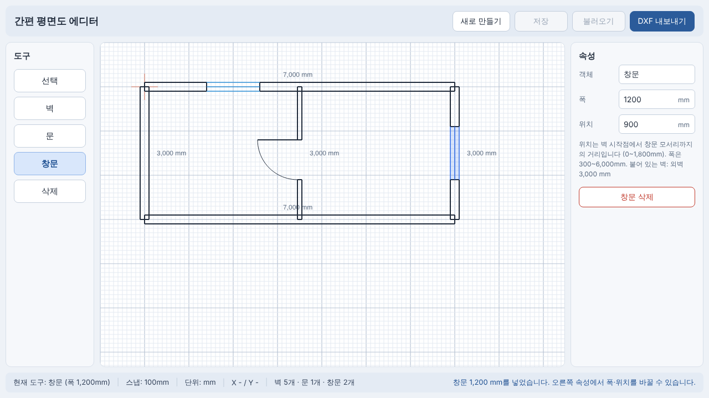
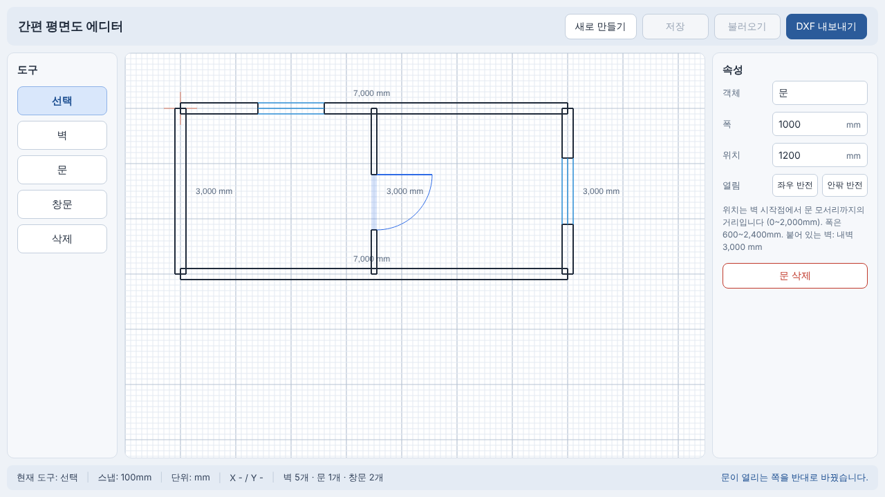
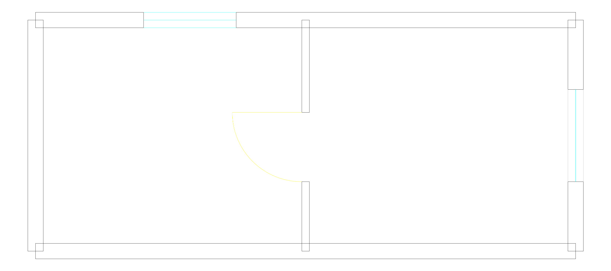

# 간편 평면도 에디터 (샘플)

브라우저의 모눈 위에 벽·문·창문을 그리면 실제 치수(mm)를 가진 평면도가 만들어지고, CAD에서 열 수 있는 DXF 파일로 내려받는 웹앱입니다.
「모눈 기반 간편 건축 평면도 DXF 출력 웹앱 개발 과업지시서」 가운데 **모눈 + 벽·문·창문 그리기와 수정·삭제 + DXF 출력**까지 구현한 샘플입니다.



## 설치와 실행

필요한 것: Node.js(현재 지원되는 LTS), Chrome 또는 Edge

```bash
cd floorplan-editor
npm install
npm run dev
```

브라우저에서 <http://localhost:3000> 에 접속합니다.

배포용으로 실행할 때:

```bash
npm run build
npm run start
```

## 사용 방법

1. 왼쪽 **[벽]** 도구에서 벽 종류(외벽 200mm / 내벽 100mm)를 고르고, 모눈에서 **시작점 → 끝점**을 클릭합니다. 클릭 위치는 가장 가까운 100mm 모눈점에 맞춰지고, 벽은 수평·수직으로만 그려집니다. 그리는 중에는 Esc로 취소합니다.
2. **[문]** / **[창문]** 도구로 벽 위를 클릭하면 그 자리에 문(폭 900mm)·창문(폭 1,200mm)이 들어갑니다. 마우스를 벽에 올리면 들어갈 자리가 점선으로 보입니다. 벽 밖, 벽보다 넓은 경우, 다른 문·창문과 겹치는 경우에는 넣지 않고 안내합니다.
3. **[선택]** 도구로 객체를 클릭하면 오른쪽 속성에서 값을 바꿉니다. Enter를 누르거나 칸을 벗어나면 반영됩니다.
   - 벽: 길이·두께·종류(종류를 바꾸면 두께가 기본값으로 바뀜). 길이를 바꾸면 시작점은 그대로 두고 끝점이 움직이며, 문·창문보다 짧게는 줄일 수 없습니다.
   - 문: 폭·위치(벽 시작점에서 문 모서리까지 거리)·열림 방향(좌우 반전, 안팎 반전)
   - 창문: 폭·위치
4. **[삭제]** 도구로 객체를 클릭하거나, 선택한 뒤 Delete 키 또는 속성의 삭제 버튼으로 지웁니다. 벽을 지우면 그 벽의 문·창문도 함께 지워집니다.
5. 마우스 휠로 확대·축소하고, 빈 곳을 끌어서 화면을 옮깁니다.
6. 상단 **[DXF 내보내기]** 를 누르면 `floorplan.dxf` 를 내려받습니다. Claude 아티팩트 링크로 열었을 때는 `.dxf` 를 직접 저장할 수 없어 `floorplan.dxf` 가 든 `floorplan.zip` 으로 내려받고, 그것도 안 되는 화면에서는 DXF 내용을 복사할 수 있는 창을 띄웁니다.



## 구현 범위

| 과업지시서 항목 | 상태 |
|---|---|
| STEP 1 모눈 화면 (100mm 얇은 선, 1,000mm 굵은 선, 확대·축소·이동, 100mm 스냅) | 구현 |
| STEP 1 화면 좌표(px)와 도면 좌표(mm) 분리 | 구현 (도면 데이터는 mm로만 저장) |
| STEP 2 수평·수직 벽, 투라인(외벽 200 / 내벽 100) | 구현 |
| STEP 2 벽 클릭 시 길이·두께 표시와 숫자 수정 | 구현 |
| STEP 3 문·창문 넣기, 폭·위치 수정, 문 열림 방향 | 구현 |
| 삭제 도구 (벽 삭제 시 붙은 문·창문 함께 삭제) | 구현 |
| STEP 5 DXF 출력 (1단위=1mm, 모델 공간 1:1, 모눈 제외, 레이어 A-WALL / A-DOOR / A-WIND) | 구현 |
| 8장 오류 처리: 0mm 벽, 벽 밖·겹치는 문·창문, 범위 밖 숫자 | 구현 (반영하지 않고 안내) |
| STEP 4 저장·불러오기 | 범위 밖 (버튼만 비활성으로 표시) |

## DXF 형식

- 단위: 헤더 `$INSUNITS = 4` (mm). CAD에서 1단위가 1mm로 열립니다.
- 레이어
  - `A-WALL`(흰색): 벽의 두 줄과 양 끝 마감선. 문·창문 자리는 비우고 양쪽에 마감선을 넣습니다.
  - `A-DOOR`(노란색): 문짝 LINE 1개 + 열리는 궤적 ARC 1개(90°)
  - `A-WIND`(하늘색): 창문 LINE 3개(바깥 두 줄 + 가운데 유리선)
- 화면 캡처 이미지가 아니라 개별 선이라 하나씩 선택·이동·측정할 수 있습니다.
- 좌표: 화면은 아래쪽이 +Y, CAD는 위쪽이 +Y입니다. 변환은 `lib/plan.ts` 의 `toCad()` 한 곳에서만 합니다. 화면 아래 상태 표시줄의 커서 좌표도 같은 함수를 써서 CAD 기준으로 보여 줍니다.
- 샘플: [samples/sample-plan.dxf](samples/sample-plan.dxf) (외벽 7,000 × 3,000mm 사각형 + 3,000mm 내벽, 문 1개, 창문 2개)



## 폴더 구조

```
app/
  page.tsx                 첫 화면 (에디터 표시)
  layout.tsx, globals.css  공통 레이아웃과 스타일
components/
  FloorplanEditor.tsx      화면 5개 구역(상단·왼쪽·중앙·오른쪽·아래쪽), 도면 상태, 벽·문·창문 속성
  PlanCanvas.tsx           Konva 모눈 캔버스: 확대·이동, 스냅, 벽 그리기, 문·창문 넣기, 선택·삭제
lib/
  plan.ts                  도면 데이터 타입, 스냅, 투라인·문·창문 모양 계산, 클릭 판정, 입력 검사, 좌표 변환
  dxf.ts                   도면 데이터 → DXF 문자열 / 파일 내려받기
  zip.ts                   아티팩트 링크용: DXF를 ZIP 하나에 담기
samples/                   샘플 DXF
docs/screenshots/          동작 화면
```

Konva 캔버스는 브라우저에서만 동작하므로 `next/dynamic` 의 `ssr: false` 로 불러옵니다(`FloorplanEditor.tsx`).

## 확인한 내용

브라우저 자동 테스트(Playwright)와 DXF 판독(Python ezdxf)으로 확인했습니다.

| 확인 작업 | 결과 |
|---|---|
| 4,000mm 수평·수직 벽 | 투라인, 두께 200/100mm 정상 |
| 대각선으로 클릭 | 많이 움직인 축으로 수평·수직 벽 생성 (3,000mm) |
| 같은 점을 두 번 클릭 (0mm 벽) | 생성하지 않고 "벽 길이가 0mm입니다" 안내 |
| 벽 길이 4,000 → 4,150mm | 끝점과 표시 길이가 함께 바뀜 |
| 길이에 0 입력 | 반영하지 않고 오류 안내 |
| 확대 후 같은 벽 선택 | 길이 4,000mm 그대로 |
| 내벽에 문, 외벽 2곳에 창문 넣기 | 벽 선이 비워지고 문(호)·창문(세 줄) 표시 |
| 창문 옆에 겹치게 창문 넣기 / 빈 곳 클릭 | 넣지 않고 "겹칩니다" / "벽 위를 클릭해 주세요" 안내 |
| 문 폭 900 → 1,000mm, 위치 2,500mm(벽 밖) 입력 | 폭은 반영, 위치는 "0~2,000mm 사이" 오류 안내 |
| 창문이 2,600mm까지 있는 벽을 2,000mm로 줄이기 | 반영하지 않고 안내 |
| 벽 종류 외벽 → 내벽 | 두께 100mm로 바뀜 |
| 삭제 도구로 창문, Delete 키로 문 달린 벽 삭제 | 창문 삭제 / 벽과 문 함께 삭제 |
| DXF 다시 읽기 | 단위 mm, 레이어 A-WALL·A-DOOR·A-WIND, 문 ARC 1개(반지름 900mm, 90°), 창문 LINE 6개 |

**AutoCAD 등 사내 CAD 프로그램에서 직접 여는 확인은 아직 하지 않았습니다.** `samples/sample-plan.dxf` 를 열어 내벽 길이가 4,000mm로 측정되는지 확인해 주세요.

## 현재 안 되는 것 / 다음 작업

- 모서리(L·T자) 접합부에서 벽 선이 겹쳐 보입니다. 과업지시서 P1 항목(접합부 정리·외곽선 중복 최소화)입니다.
- 실행 취소(Ctrl+Z)가 없습니다.
- 벽을 옮기거나 문·창문을 끌어서 옮기는 기능은 없습니다. 위치는 속성에서 숫자로 바꿉니다.
- 방 이름(거실·침실) 글자 넣기는 아직 없습니다.
- 새로고침하면 도면이 사라집니다. 저장·불러오기(localStorage, JSON)는 STEP 4에서 구현합니다.
- 모바일은 지원하지 않습니다(과업지시서 범위대로 PC 브라우저 우선).
