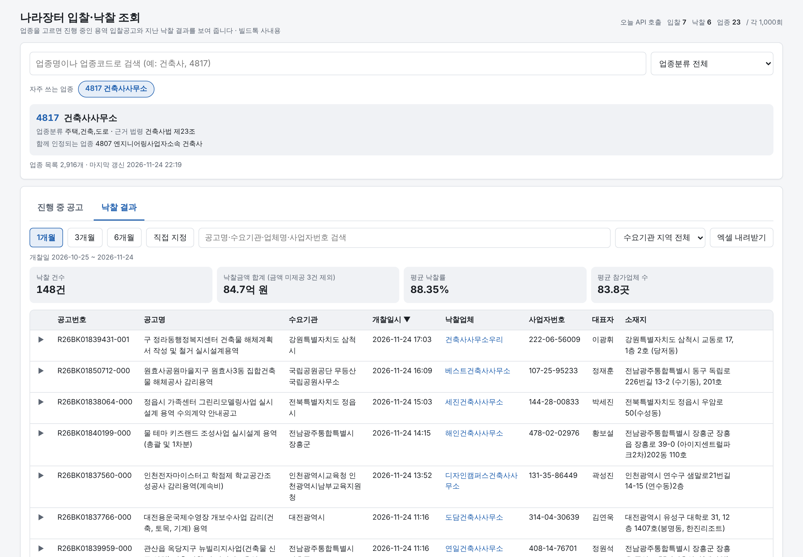

# 나라장터 입찰·낙찰 조회 (빌드톡 사내용)

업종을 고르면 나라장터의 **진행 중인 용역 입찰공고**와 **지난 낙찰 결과**를 보여 주는 웹사이트입니다.
조달청 공공데이터 API 세 가지를 씁니다.

| 화면 | API | 기능 |
|---|---|---|
| 업종 선택 목록 | 업종 및 근거법규서비스 | `getIndstrytyBaseLawrgltInfoList` |
| 진행 중 공고 | 입찰공고정보서비스 | `getBidPblancListInfoServcPPSSrch02` (지역·면허는 `...PrtcptPsblRgn02`, `...LicenseLimit02`) |
| 낙찰 결과 | 낙찰정보서비스 | `getScsbidListSttusServcPPSSrch` |



## 주요 기능

- **업종 선택**: 업종 API에서 받은 2,916개 업종 중에서만 고릅니다. 업종명·코드 일부로 검색하고(예: "건축사" → 4807, 4808, 4817), 업종분류로 거를 수 있습니다. 자주 쓰는 업종 버튼과 최근 고른 업종 5개도 보여 줍니다.
- **진행 중 공고**: 최근 7·14·30일에 게시된 공고 중 마감 전인 것. 같은 공고는 최신 차수만 남기고, 최신 차수가 취소공고면 뺍니다. 행을 펼치면 참가가능지역·면허 제한·첨부파일을 불러옵니다.
- **낙찰 결과**: 개찰일 기준 1·3·6개월 또는 직접 지정(최대 1년). 요약 카드, 업체별 집계(사업자번호 기준), 업체를 누르면 그 업체 낙찰만 보기. 행을 펼치면 공고기관·계약방법·추정가격을 불러옵니다.
- 공통: 검색, 열 정렬, 수요기관 지역 필터(기관명으로 판단), 엑셀 내려받기, 오늘 API 호출 수 표시, 휴대폰 화면 대응.
- 주소에 `?code=4817&tab=awards` 가 붙어서, 링크를 공유하면 같은 업종·탭으로 열립니다.

## API 제약과 대응

- 입찰·낙찰 조회 기간은 **달력 날짜로 최대 7일**(넘으면 오류 07). 화면이 기간을 7일 구간으로 나눠 차례로 부르고 "2/5 구간 조회 중"처럼 진행 상황을 보여 줍니다.
- 개발계정은 **API마다 하루 1,000회**. 그래서 결과를 서버에 저장해 같은 조건은 다시 부르지 않습니다.
  - 입찰공고: 오늘이 들어간 구간 1시간, 지난 구간 12시간
  - 낙찰: 오늘이 들어간 구간 1시간, 최근 2주 12시간(늦게 등록되는 결과 반영), 그 이전 30일
  - 업종 목록: 하루 1회 갱신. 실패하면 저장된 목록 → `data/industries-seed.json`(2026-11-24 수집) 순으로 씁니다.
  - 지역·면허·공고 정보는 행을 펼칠 때만 부릅니다.
- `numOfRows`는 999(넘기면 API가 10건만 줌). 연결이 끊기면 1·2·4초 간격으로 다시 시도합니다.
- 낙찰 API는 구간마다 겹치는 결과와 실제 개찰일이 기간 밖인 결과를 섞어 줍니다. 중복을 없애고 기간 밖은 빼며, 뺀 건수를 화면에 적습니다.
- 낙찰 API에는 공고기관·계약방법·추정가격이 없습니다. 목록 전체에 붙이면 건마다 입찰공고 API를 1회씩 더 불러야 해서, 행을 펼칠 때만 불러옵니다.

## 로컬 실행

```bash
npm install
cp .env.example .env.local   # DATA_GO_KR_KEY 에 공공데이터포털 일반 인증키를 넣는다
npm run dev                  # http://localhost:3000
```

- 로컬에서는 API 응답이 `.cache/` 폴더에 저장됩니다. **캐시 지우기**: `rm -rf .cache`
- **업종 목록 수동 갱신**: 브라우저나 curl로 `/api/industries?refresh=1` 을 엽니다.
- 회사·클라우드 프록시 뒤에서 실행할 때는 Node의 fetch가 프록시를 쓰도록 `NODE_USE_ENV_PROXY=1 npm run dev` 로 실행합니다.
- 초기 업종 데이터 다시 만들기: `node scripts/make-seed.mjs <업종 API 원본 JSON> <수집일>`
- 자주 쓰는 업종 버튼은 `config/favorites.ts` 에서 고칩니다.

## 환경 변수

| 이름 | 필수 | 설명 |
|---|---|---|
| `DATA_GO_KR_KEY` | 예 | 공공데이터포털 일반 인증키(세 API 공통). 서버에서만 읽고 화면·응답·로그에 나오지 않습니다 |
| `SITE_PASSWORD` | 배포 시 권장 | 넣으면 비밀번호를 아는 사람만 들어올 수 있습니다. 바꾸면 기존 로그인이 모두 풀립니다 |
| `KV_REST_API_URL`, `KV_REST_API_TOKEN` | 배포 시 권장 | Upstash Redis(Vercel Storage) 연결 정보. 연결하면 Vercel에 자동으로 들어갑니다. `UPSTASH_REDIS_REST_URL/TOKEN` 이름도 받습니다 |
| `DAILY_LIMIT` | 아니오 | 화면에 보여 줄 일일 한도(기본 1000). 운영계정으로 바꾸면 고칩니다 |
| `CACHE_DIR` | 아니오 | Redis가 없을 때 파일 캐시 위치 |

## Vercel 배포 (무료 Hobby)

1. Vercel에 GitHub 계정으로 로그인 → **Add New → Project** → 이 저장소를 Import
2. **Root Directory** 를 `g2b-bid-search` 로 지정 (Framework는 Next.js로 자동 인식)
3. **Environment Variables** 에 `DATA_GO_KR_KEY`, `SITE_PASSWORD` 를 넣고 Deploy
4. 배포 후 프로젝트의 **Storage → Upstash (Redis) → Create** 로 무료 데이터베이스를 만들어 이 프로젝트에 연결하고 **Redeploy**
   - 연결하지 않아도 동작은 하지만, 서버 인스턴스가 바뀔 때마다 캐시가 사라져 API 호출이 늘어납니다.
5. 서버 지역은 `vercel.json` 에서 서울(`icn1`)로 지정했습니다. 공공데이터포털이 해외 IP를 막는 경우를 피하기 위해서입니다.

> 참고: Vercel 기본 배포 브랜치는 `main` 입니다. 다른 브랜치에 있는 코드는 `main` 에 합치거나, Vercel의 Settings → Git → Production Branch 를 바꿔야 운영 주소에 반영됩니다.

## 폴더 구조

```
app/            화면(page.tsx, login) 과 서버 API(app/api/*)
components/     화면 구성 요소 (업종 선택, 진행 중 공고, 낙찰 결과, 표 공통)
lib/            날짜·지역·업종 검색 등 공용 함수
lib/server/     공공데이터 API 호출, 캐시, 업종 목록 (서버 전용)
proxy.ts        사내용 비밀번호 확인
data/           업종 초기 데이터
config/         자주 쓰는 업종
docs/screenshots 화면 캡처
```

## 출처

조달청 나라장터 공공데이터 API (공공데이터포털). 나라장터 상세 페이지는 로그인이 필요해 링크만 겁니다.
